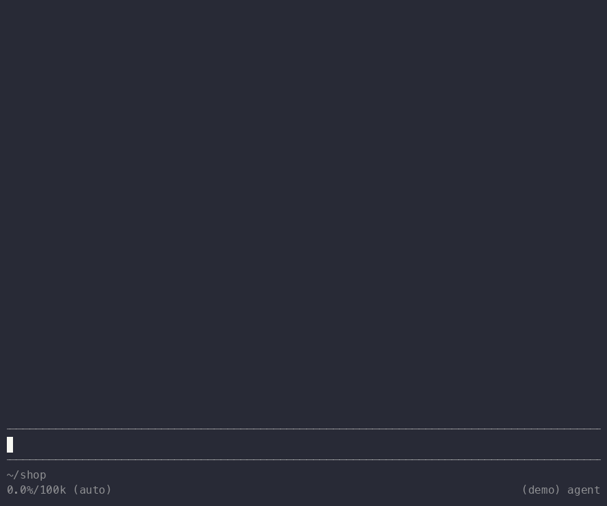

# pi-infer-questions

A [pi](https://github.com/earendil-works/pi) extension that finds the
questions in the agent's replies and lets you answer them with a click.
A small local model reads each reply. It makes no tool call and no
network request.

After each question in a completed reply, the extension adds controls:

| Question | Controls |
|---|---|
| A choice ("Should I push now, or wait for CI?") | each option in place, then **Other** |
| A choice with one option | the option, then **Yes** / **Other** |
| A yes/no question or a proposal ("I recommend X. Say the word.") | **Yes** / **No** / **Other** |
| An open question ("What should the name be?") | **Answer** |

A click sends nothing. It puts the question, as a quote, and your
answer in the editor:

    > Should I push now, or wait for CI?

    wait for CI

You can answer several questions, edit the text, and then submit. A
second click on the same question replaces its answer.

The extension also adds five short rules to the system prompt that tell
the agent to ask its decisions as clear questions at the end of the
reply. The model finds these more reliably. Start pi with
`--no-question-guide` to turn the rules off.

## Install

    pi install npm:@andreypopp/pi-infer-questions

Then restart pi. The extension needs:

- pi in fullscreen mode (`"tuiMode": "fullscreen"` in
  `~/.pi/agent/settings.json`). Clicks work only in fullscreen mode.
- macOS 15 or later on Apple silicon (the model runs on the Neural
  Engine), or Linux with glibc on arm64 or x64 (the model runs on the
  CPU). On x64, CPUs without AVX-512 VNNI can give less accurate
  options.

npm downloads only the package for your platform: about 120 MB on
macOS, 80 MB on Linux. On other platforms, pi shows one notice and
renders replies as usual.

## How it works

When a reply is complete, a native module (Swift) does these steps in
the pi process:

1. It splits the Markdown into paragraphs and lists.
2. It skips the parts without `?` and without a decision word.
3. A question tagger (a 32M-parameter encoder) marks each question
   sentence and its kind: yes/no, open or choice.
4. An option tagger marks the options of each choice question.

A reply takes a few milliseconds. See [docs/design.md](docs/design.md).

## Quality

Held-out evaluation on 3,060 parts of real coding-agent replies, with
whole-sentence spans:

| | |
|---|---|
| Questions with `?` found | 87% |
| Proposals without `?` found | 67% |
| Question F1, exact / overlapping span | .741 / .828 |
| Kind accuracy | .963 |
| Option F1, end to end | .579 |
| Parts without a question that get one | 3.3% |

The shipped Neural Engine and ONNX models are within .02 of these
numbers. Parts with neither `?` nor a decision word never reach the
model, and the table does not count their questions.

## Development

To build, you need Node 24 or later with its headers, Swift 6, cmake
and curl.

    make          # builds the native module and links it into node_modules
    make smoke    # the native module against the golden file
    make e2e      # pi in fullscreen on a private tmux server
    make npm      # npm tarballs for this platform into build/npm-dist
    make demo     # records docs/demo.gif (needs asciinema and agg)

To use the checkout in pi, add `"<checkout>/extension.ts"` to
`extensions` in `~/.pi/agent/settings.json`. If `data/` has no models,
`make` takes them from the published npm package. On Linux,
`linux/Containerfile` gives a build environment.

## Train your own model

The pipeline is in [pipeline/](pipeline/). The training data is not
published: it comes from your own pi and Claude Code transcripts, and
DeepSeek labels it (an API key and a few dollars).

    cd pipeline
    uv sync
    export DEEPSEEK_API_KEY=...
    uv run corpus                     # units from ~/.pi and ~/.claude transcripts
    uv run label-corpus --take question=all --take pool=all
    uv run synth --calls 100 --batch base     # optional synthetic messages
    uv run train --synth base         # seeds 0-2, selects one on dev
    uv run train --eval               # once, on the held-out split
    uv run convert-ane && uv run parity-ane && uv run golden-ane     # macOS
    uv run convert-onnx && uv run parity-onnx && uv run golden-onnx  # Linux
    uv run pytest

`uv run extract FILE` prints the questions in a file with the PyTorch
model. `uv run label FILE` prints DeepSeek's labels.

`corpus` copies every assistant message under `~/.pi/agent/sessions`
and `~/.claude/projects` into `data/messages.jsonl`, which is not in
git. Before anything goes to DeepSeek, it replaces your user name, home
paths, email addresses and the secrets that it recognizes. It does not
know the names of your private projects. The published models are
trained on the author's transcripts after this redaction. The golden
files contain only fixtures and synthetic messages.

## License

Apache-2.0. The models are fine-tuned from
[jhu-clsp/ettin-encoder-32m](https://huggingface.co/jhu-clsp/ettin-encoder-32m)
(MIT); see [NOTICE](NOTICE).
